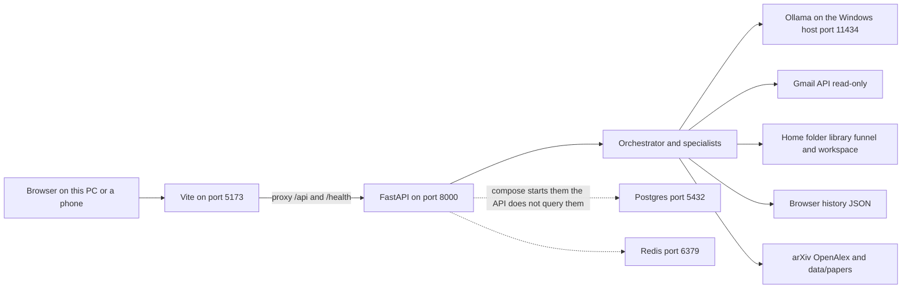
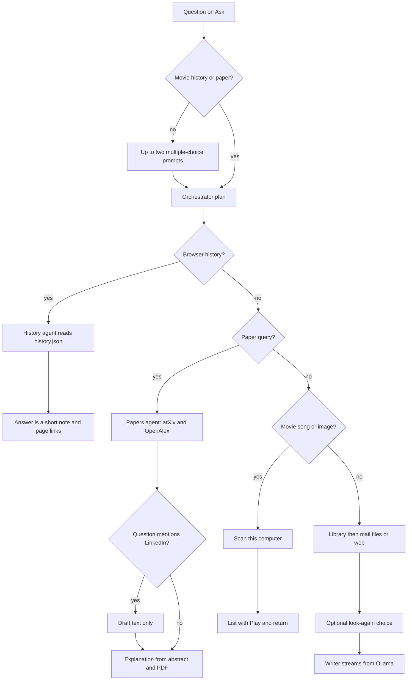
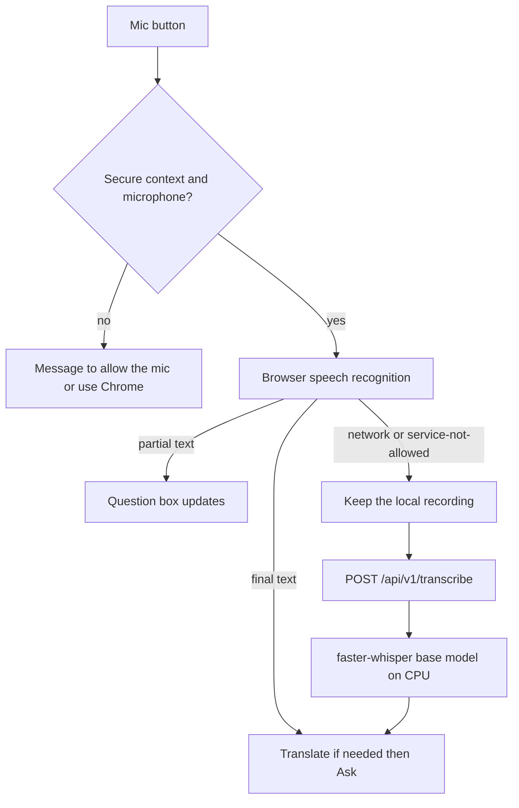
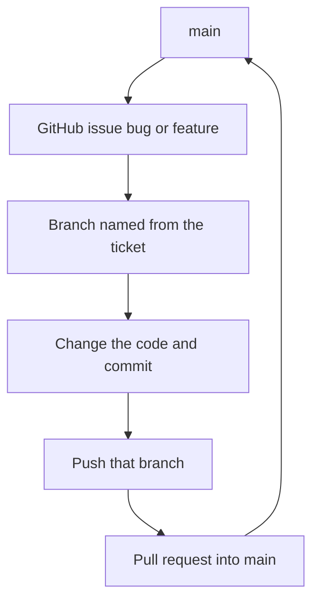

# Asteria product guide

This file describes the Asteria tree in this repository as the code works today. The root `README.md` still says Sprint 0 and “no agents yet.” That sentence is out of date. Agents, Ask, the library, the funnel, voice, browser history, and papers are implemented. Some screens and packages are still placeholders. Those are called out below.

Asteria is a local assistant. You ask a question in the browser. A FastAPI process on this computer chooses specialists, gathers evidence, and writes an answer with a local Ollama model. Movies, songs, and images already on the computer can be played. Files can move between this computer and a phone on the same Wi-Fi. Mail is read-only. Research papers are fetched from arXiv. LinkedIn posting from Ask is a draft only.

Nothing in this guide downloads torrents. The repository has no torrent or magnet code.

## How to run it

Postgres, Redis, and the API run in Docker. The UI runs on the Windows host with Vite. Ollama is a Windows process. Compose does not start Ollama.

From the repo root:

```powershell
cd C:\Users\kunal\work\AI_Platform
docker compose up -d
```

In another terminal:

```powershell
cd C:\Users\kunal\work\AI_Platform\frontend
npm install
npm run dev
```

If the model is missing:

```powershell
ollama pull llama3.2
```

- UI: http://localhost:5173
- API docs: http://localhost:8000/docs
- Health: http://localhost:8000/health

`/health` returns `status: ok` and still includes a note that says agents are not implemented. That note is stale. The agent planner in `backend/agents/group.py` is what Ask uses.

There is also `infrastructure/docker/frontend.Dockerfile` and `infrastructure/docker/nginx.conf`. They can build a static UI behind nginx on port 80. `docker-compose.yml` does not start that container. Day-to-day use is Vite on port 5173.

## System



The browser talks only to Vite. Vite proxies `/api` and `/health` to `http://127.0.0.1:8000` with no timeout, so a long answer can stream. Vite binds `host: true`, so a phone on the same network can open the UI. The sidebar reads `/lan.json`, which Vite builds from this machine’s LAN address. It prefers a `192.168.` address, then a `10.` address.

The API container reaches Ollama at `http://host.docker.internal:11434`. Compose adds that hostname. The default model name in settings is `llama3.2`. If that name is not installed, the writer tries `llama3.1:latest`, then `qwen3:8b`, then `gemma3:latest`, then the first model Ollama lists.

### Ports

| Port | Process | Role |
| --- | --- | --- |
| 5173 | Vite on the host | UI. CORS also allows 5174. |
| 8000 | uvicorn in the backend container | FastAPI. |
| 5432 | postgres:16-alpine | Database container. The running API does not query it. |
| 6379 | redis:7-alpine | Cache container. The running API does not query it. |
| 11434 | Ollama on Windows | Local chat and optional embeddings. |

### Volume mounts

| Host path | Container path | Mode | What it is for |
| --- | --- | --- | --- |
| `%USERPROFILE%` | `/host-home` | read-only | File, movie, song, and image search. Also the Chrome and Edge profile folders history is copied from. |
| `./data/workspace` | `/workspace` | read-only | Small sample workspace, including `documents/north-region-note.md`. |
| `./data/library` | `/library` | read-write | Uploads, captures, `index.json`. |
| `%USERPROFILE%\Desktop\Asteria` | `/funnel` | read-write | Phone uploads land here. |
| `./data/sessions` | `/sessions` | read-write | `session.json` for threads and checkpoints. |
| `./data/browser-history` | `/browser-history` | read-write | `history.json`. |
| `./data/papers` | `/papers` | read-write | Downloaded arXiv PDFs. |
| `./data/models` | `/models` | read-write | faster-whisper model files. |
| `%USERPROFILE%\.gmail-mcp` | `/gmail-mcp` | read-write | OAuth client file and Gmail token. Not in git. |
| `%USERPROFILE%\.linkedin-mcp` | `/linkedin-mcp` | read-write | LinkedIn app keys and token. Not in git. |
| Docker volume `postgres_data` | Postgres data dir | read-write | Database files. |

`FILE_SEARCH_ROOTS` is `/host-home`, so search walks the mounted home folder, then adds the workspace root. Hidden names, `AppData`, `node_modules`, `.git`, virtualenvs, and similar directories are skipped. Paths are checked so a request cannot escape the chosen root.

Gmail’s API scope is read-only. The token folder is still mounted read-write so a refresh can update `credentials.json` outside the repo. The home folder used for file search is the read-only mount.

The backend image is Python 3.12. It installs `backend/requirements.txt`, then `ffmpeg`, `libgomp1`, and `faster-whisper==1.2.0`. `faster-whisper` is not listed in `requirements.txt`. It is installed in the Dockerfile because local transcription needs it. An optional extra CA file at `infrastructure/docker/certs/*.crt` is gitignored and appended at image build so pip can trust a machine that inspects TLS.

## Ask a question

The home page is Ask (`frontend/src/pages/WorkspacePage.tsx`). A question of at least 3 characters becomes an investigation.

1. The page calls `POST /api/v1/investigations` with the question, the selected Ollama model, a time limit (30, 45, or 60 seconds in the sidebar; the API accepts 20 to 120), an answer length (`brief`, `clear`, or `full`), and the current thread id if there is one.
2. The API opens or reuses a thread, stores the investigation in process memory, and starts a background worker.
3. The page listens to `GET /api/v1/investigations/{id}/events` as server-sent events. Tokens, stages, evidence, choices, and the final answer arrive on that stream.
4. If the selected language is not English, the page translates the question to English before step 1, and translates the finished answer back for display and speech.



### Orchestrator

`backend/agents/group.py` builds the speaking order. `backend/gateway/router.py` runs it. The roster names in code are orchestrator, movies, files, mail, library, web, history, papers, linkedin, and writer. A song or image question is planned as `songs` or `images`. Those names are not separate roster entries. They use the same media scan as movies, with audio or image file types.

The plan is keyword routing, not a model call:

- History phrases such as “browser history”, “what did I visit”, or “my history” go to history, then writer. The writer stage is marked complete, but the text is a fixed note, not an Ollama paragraph.
- Movie, film, video, song, music, photo, or picture questions that are not about weather, mail, news, or papers go to the matching media agent and return after the list.
- arXiv, research paper, citation, or famous-paper wording goes to papers. If the question also says LinkedIn, the plan includes a linkedin step that only drafts text.
- Phrases such as “on my computer” or “my files” go to the file agent.
- Gmail, inbox, or email wording adds the mail agent.
- Anything else, or an explicit web or weather question, adds the web agent.
- The writer is last, except the early returns above never call Ollama.

Library search still runs on the non-media path and its hits are added to the evidence. It is not a separate early return.

### Clarify before the run

For ordinary questions, `backend/gateway/clarify.py` asks up to two multiple-choice questions before tools run. Movie, history, and paper questions skip this. Each prompt waits 20 seconds. If you do not choose, the first option is used.

Examples of what the choices change:

- Weather with no place: Kolkata, Mumbai, Delhi, or Bengaluru, then “right now”, “the whole day”, or “should I go out”.
- Local files: list, summarize, or compare, then how many files to open.
- Mail: latest, unread, or oldest, then one line or a few details.
- Other questions: a direct answer, the latest, or an overview, then how long the telling should be.

The choice is appended to the question as plain words. A custom site name is stripped to letters, numbers, dots, spaces, and hyphens, and capped at 60 characters.

### While tools run

After sources arrive, and only when the deadline has not passed, one more prompt asks whether to write from what was found or look again. That wait is 15 seconds. “Use what was found” continues. A narrower or broader choice, or a named site, runs web search once more. Weather can also ask for AccuWeather or IMD.

The sidebar clock is a hint. When it expires, the UI says the work continues in the session and you can ask the next question. The Ollama stream itself is not cut off. `stream_answer` ignores the deadline argument.

### Writer

For the normal path, evidence is joined and capped at 12,000 characters. The writer calls Ollama `POST /api/chat` with streaming. The system instruction is to answer only from the evidence and name each source. Answer length maps to a generation cap: short is about two or three sentences (`num_predict` 800), clear is one short paragraph (1400), full is a few short paragraphs (2200). Thinking tokens, when the model sends them, show separately from the answer.

If Ollama has no model, the raw evidence is shown. If a tool throws, that specialist is marked complete with the error type and the run continues. If the whole worker throws, the investigation is still marked completed and the hint says what was already found.

Confidence is `0.7` when any source was attached, otherwise `0.3`. That number is assigned in code. It is not a measured score.

### Review after the answer

When the run finishes, Ask shows “Does this answer work?” Choices are “this is enough”, “try again, shorter”, and “try again, different pages”. Weather adds “try again from the weather report”. Retry calls `POST /api/v1/investigations/{id}/retry`, starts a new investigation on the same thread, and skips the opening multiple-choice round. “This is enough” leaves the answer as it is.

`POST /api/v1/chat` runs the same worker and waits until it finishes. The UI does not use that route. It uses the streaming investigation route.

## Threads, checkpoints, and memory

Threads live in `data/sessions/session.json` (`SESSIONS_ROOT` is `/sessions` in Docker). This file is gitignored.

One session file holds up to 40 threads. Each thread stores a title, turns, a memory string, up to 20 checkpoints, and the latest investigation id.

- `GET /api/v1/threads` lists threads, newest first.
- `POST /api/v1/threads` creates one.
- `POST /api/v1/threads/{id}/restore` with a checkpoint id puts that checkpoint’s turns and memory back.

Ask creates a thread on the first question if you did not pass one. Each finished answer appends the question and the answer, keeps the last 40 turns, rebuilds memory from the last 8 turns (each clipped), and saves a checkpoint labeled with the question. Restoring a checkpoint does not delete later checkpoints. It sets the active memory back to the chosen one so the next question sees that context.

The writer receives that thread memory as “This thread’s memory”.

There is a second memory in `backend/gateway/memory.py`. It keeps the last 8 question-and-answer pairs in the API process and can rewrite a short follow-up by prefixing the previous question. The investigation worker always passes thread memory into the router, including an empty string, so that rewrite is not used for Ask. `remember()` still records each finished answer in the process. Restarting the API clears process memory and the in-memory investigation list. `session.json`, the library, history, and papers stay on disk. Old investigation ids will 404 after a restart because they were never written to Postgres.

## Voice

Languages in the Ask box are English, Hindi, Bengali, Marathi, Tamil, Telugu, Kannada, Malayalam, and Japanese. The choice is stored in `localStorage` under `asteria-language`.



The mic starts the browser’s `SpeechRecognition` (or `webkitSpeechRecognition`) and, at the same time, a `MediaRecorder` on the microphone. A volume check stops the recording after speech and a short quiet gap. You can also press Stop.

If cloud speech returns text, that text is used. If cloud speech fails with `network` or `service-not-allowed`, the page says it is listening on this computer and sends the recording to `POST /api/v1/transcribe`. The comment in `backend/servers/speech_server.py` describes this case: Chrome’s cloud speech often fails when the connection is inspected. The recording is then read locally.

Local transcription:

- Languages allowed match the Ask list. Anything else is treated as English.
- Recordings over 8 MB are rejected. Under about 400 bytes, the API returns empty text.
- The model is faster-whisper `base`, CPU, int8. Weights download into `data/models` the first time.
- Segments that look like silence, and short stock phrases such as “thanks for watching”, are dropped.
- The first run can take about a minute while the model loads. The UI says so.

If the language is not English, `translateText` runs before Ask. It tries the browser’s built-in Translator when that API says it is already available. Otherwise `POST /api/v1/translate` calls the public Google translate endpoint and, if that fails, MyMemory. Chunks are about 450 characters. If translation fails, Ask still sends the original text. After the answer, the same function translates English back into the selected language for the on-screen text. The speaker button uses `speechSynthesis` with a voice whose language prefix matches, on up to 3,500 characters.

The phone page needs a secure context before `getUserMedia` will open. Vite on plain `http://` to a LAN IP may not qualify. The mic error text says to use Chrome on this computer, or a secure address on the phone.

## Movies, songs, and images

A question such as “list movies” or “play songs” does not call Ollama. The file server walks the read-only home mount and the workspace. It skips hidden and heavy directories. A catalog request (“list”, “all”, “every”, “show”) with no extra name terms lists the type. Name terms filter the filename. The scan stops after 45 seconds for a catalog and 25 seconds otherwise. At most 80 matches are returned.

Catalog size floors, so tiny files are not treated as a library:

- Video: 8 MB
- Audio: 100 KB
- Image: 30 KB

Each hit that sits under a search root becomes a source with a Play path. The answer text is a count, for example “12 of 40 movies on this computer. Choose Play on the one you want.”

Play uses the funnel routes, from Ask and from the Funnel page:

- MP4, MOV, WebM, audio, and images use `GET /api/v1/funnel/play`. The browser plays the original file. Nothing is copied into the library.
- MKV and AVI use `POST /api/v1/funnel/play/session`. `ffmpeg` and `ffprobe` must be on the PATH. The container image installs ffmpeg. The file stays on disk. ffmpeg writes a short HLS playlist under `/tmp/asteria-play` inside the container.
- H.264 and HEVC pictures are copied when the phone can already decode them. Other video is re-encoded with libx264. Audio is copied when it is already AAC, otherwise encoded to AAC.
- Segments are 6 seconds. The phone player is `hls.js` in `MediaPlayer`. The note on screen says whether the picture was copied or converted, and that nothing is saved on the phone.
- Files larger than 16 GB are refused for play and for send.

Only one HLS session is kept. Starting another kills the previous ffmpeg process.

## Library

The Library page uploads a file or captures audio, video, or a photo in the browser. `POST /api/v1/library/items` stores it. The cap is 100 MB per file. Kinds are `file`, `image`, `audio`, and `video`.

Layout under `data/library`:

```text
data/library/
  index.json
  video/YYYY/MM/DD/<place>-YYYYMMDD-HHMM-<name>.<ext>
  audio/YYYY/MM/DD/...
  image/YYYY/MM/DD/...
  document/YYYY/MM/DD/...
  spreadsheet/YYYY/MM/DD/...
  other/YYYY/MM/DD/...
```

`place` comes from the note you typed. If the note is empty and the file is a JPEG with GPS, the name uses a rounded latitude and longitude. Otherwise the folder name uses `unplaced`. Audio and video also get a sidecar `<name>.transcript.json` next to the file. A transcript typed or captured in the browser is stored with method `browser-speech`. If there is no transcript yet, the method is `pending`.

`index.json` holds metadata and an embedding. Embeddings prefer an Ollama embed model if one of `nomic-embed-text`, `mxbai-embed-large`, or `all-minilm` is installed and answers. Otherwise a local 256-dimension hash embedding named `hash-v1` is used. Ask searches the library by that vector and by keywords, and keeps hits with a strong enough score, up to four. PDF, Word, text, and CSV text is extracted for search. The embedding itself is not returned to the browser.

`data/library/items/` and `data/library/index.json` are gitignored. Do not commit them.

## Funnel

Funnel is the shelf between this computer and a phone on the same Wi-Fi. Open `/funnel` on the phone using the LAN URL from the sidebar.

- Browse lists up to 300 entries per folder. Secret names are hidden: `.env`, `.netrc`, `credentials.json`, key files, `.pem`, `.key`, certificate bundles, and folders such as `.ssh`, `.gmail-mcp`, `.linkedin-mcp`, `.aws`, and `.gnupg`.
- Search uses the same filename scan as Ask, up to 12 hits.
- “Send to phone” downloads one file (`GET /api/v1/funnel/file`) or a folder as a zip (`GET /api/v1/funnel/folder`). The zip is streamed uncompressed so a movie and its subtitles are not copied into a second full file on disk. The walk is at most two folders deep and 200 files. Over 16 GB is refused.
- A movie folder is marked when it contains a video file, and the subtitle count (`.srt`, `.vtt`, `.ass`, `.ssa`, `.sub`, `.idx`) is shown.
- A file sent from the phone (`POST /api/v1/funnel/inbox`) is written to `%USERPROFILE%\Desktop\Asteria`. The same 16 GB cap applies. Hidden or secret names are rejected.

Play on the Funnel page uses the same direct-or-HLS path as Ask.

## Browser history

`backend/servers/browser_history.py` copies Chrome, Chrome Beta, and Edge history from the read-only home mount:

- `AppData/Local/Google/Chrome/User Data/<profile>/History`
- Chrome Beta in the matching folder
- `AppData/Local/Microsoft/Edge/User Data/<profile>/History`

Chrome locks its database while it is open, so each sync copies the file (and WAL/SHM sidecars when it can) and reads the copy. The API starts this loop on startup and repeats it every 180 seconds. If a TCP connection to `1.1.1.1`, `8.8.8.8`, or `9.9.9.9` on port 443 fails, the sync is skipped and the existing store is left as it is.

Visits are written to `data/browser-history/history.json`. The store keeps at most 4,000 visits, newest first. Each sync reads up to 5,000 visit rows per profile. Duplicate browser, profile, URL, and timestamp rows collapse. Answers return at most 15 pages, and by default one row per URL unless you ask for every visit.

URLs are cleaned before they are stored. `javascript:`, `data:`, `file:`, and `blob:` links are dropped. Password-reset and magic-link paths are dropped. Query keys that look like tokens, passwords, or session ids are stripped. This file is gitignored.

Ask treats a question as history when it is about your own browsing, not “the history of” a topic, not weather, not mail, and not a movie request. Time words use the offset in `HISTORY_UTC_OFFSET`, which Compose sets to `+05:30`: today, yesterday, last night, and last week. The answer lists matching pages and tells you to open a link. It does not call Ollama.

## Papers

A question about an arXiv paper, a research paper, citations, or a famous paper on a topic goes to `backend/servers/papers_server.py`. Movie and mail questions are excluded unless they clearly name arXiv or LinkedIn.

The agent:

1. Strips instruction words and keeps the topic.
2. Searches the public arXiv export API and OpenAlex. OpenAlex does not use an API key. The user agent is `Asteria/0.1 (mailto:asteria@localhost)`.
3. Ranks by citation count and picks one paper. Up to two runners-up are attached as extra links.
4. Downloads `https://arxiv.org/pdf/<id>.pdf` into `data/papers/<id>.pdf` when the body is a PDF between 1,000 bytes and 40 MB. A valid file already on disk is reused.
5. Extracts a short excerpt with `pypdf`.
6. Writes the explanation in code from the title, authors, year, OpenAlex citation count, abstract sentences, and a PDF sentence. This path does not call Ollama. Answer length still changes how many sentences are kept: brief, clear, or full.

The answer includes the arXiv abstract link and the saved path `data/papers/<file>.pdf`. `data/papers/` is gitignored.

If the question also contains “linkedin” or “linked in”, a draft post is appended. The draft is title, authors, year, citation count, two abstract sentences, and the arXiv link, capped at 2,900 characters. The answer then says posting needs a LinkedIn connection which is not set up yet. The LinkedIn stage is marked “Not connected”. That sentence is fixed in the Ask path. It does not check whether OAuth succeeded.

## LinkedIn

Say this plainly: Ask does not publish to LinkedIn.

What the code does:

- The Ask page has a Connect LinkedIn link to `GET /api/v1/linkedin/connect`.
- If `%USERPROFILE%\.linkedin-mcp\oauth.keys.json` is missing, that page explains how to create a LinkedIn app, set the redirect URL to `http://localhost:8000/api/v1/linkedin/callback`, and save `client_id` and `client_secret` outside the repo.
- If the keys exist, the browser is sent to LinkedIn OAuth with scopes `openid profile w_member_social`. The callback stores a token in `.linkedin-mcp\token.json` and returns you to the UI with `?linkedin=connected` or an error.
- `publish_text` in `backend/mcp/linkedin_client.py` can POST to `https://api.linkedin.com/rest/posts`. No Ask, papers, or router code calls it.

So Connect can store a token, and a paper question can show a draft, and the draft is not sent. Keys and tokens are gitignored. Do not commit them.

## Gmail

Mail questions use the Gmail API with scope `https://www.googleapis.com/auth/gmail.readonly`. The client reads message metadata only: From, Subject, Date, and the snippet. It does not ask for send, modify, or full body scope.

Sign-in is a one-time script, not a button in the UI:

```powershell
cd C:\Users\kunal\work\AI_Platform\backend
python gmail_auth.py
```

That script expects the OAuth client file at `%USERPROFILE%\.gmail-mcp\gcp-oauth.keys.json` and writes the token to `%USERPROFILE%\.gmail-mcp\credentials.json`. Both are outside the repo. `gmail_auth.py` injects `truststore` so the Google login can work on a network that inspects TLS.

Search scope follows the question: unread, last day, last week, last month, or recent. “Oldest” or “when was the account created” walks message pages and uses the earliest message date. The writer prompt says the API has no official account-creation time, so the answer must call that the earliest email found.

If the token is missing, the mail agent fails, the run continues, and the hint names the error type.

## Web and weather

Web search posts to the DuckDuckGo HTML endpoint and parses result links. If that returns nothing, it tries the DuckDuckGo instant-answer JSON API. The first result page is fetched and clipped to 1,500 characters.

Weather uses Open-Meteo geocoding and the forecast API when the question mentions weather, temperature, forecast, humidity, or rain and names a place after “in”, “at”, or “for”. Indian city names prefer a match in India. A weather source is quoted directly at the start of the answer, then the writer still summarizes the rest of the evidence.

## Files, documents, and spreadsheets

Local-file questions (“on my computer”, “my files”, and the phrases in `wants_local_files`) scan filenames for words of four letters or more, up to six terms, for about 25 seconds. The clarify step can limit the open count to the best match, a few, or the search cap. Each hit is typed and then read:

- PDF, Word, text, Markdown, and RTF go through the document reader. PDF text is the first pages, capped around 8,000 characters.
- CSV and Excel go through the spreadsheet reader. Excel reads the active sheet, about 20 rows, with `openpyxl` in read-only mode.
- Other types are reported as found but not read.

Workspace-relative tools (`file.list`, `file.search`, document search, spreadsheet list) look at `data/workspace`, which is mounted read-only. The sample note there is for those readers.

## Postgres and Redis versus investigations

Compose starts both and waits until they are healthy before the API container starts.

Postgres runs `infrastructure/postgres/init.sql` once on an empty data volume. That script creates `users` and `investigations` tables and inserts `local@asteria.local`. The application code does not import SQLAlchemy or asyncpg. `DATABASE_URL` is only a setting. Investigations live in `backend/models/store.py`, a dictionary in the API process. Restarting the backend drops them.

Redis is the same story. `REDIS_URL` is a setting. No module imports the `redis` package. The container answers `PING` and then sits unused.

The health payload still says Postgres is optional until a later sprint and that agents are not implemented. Trust the code paths above, not those two sentences.

These packages are in `backend/requirements.txt` because they were planned for that database work: `sqlalchemy`, `asyncpg`, and `redis`. They are installed in the image. They are not called.

## Screens

Mounted routes in `frontend/src/App.tsx`:

| Path | Page | What you get |
| --- | --- | --- |
| `/` | Ask | Question, voice, threads, choices, answer, Play. |
| `/library` | Library | Upload and capture. |
| `/funnel` | Funnel | Browse, send, play. |
| `/security` | Security | Counts from `GET /api/v1/security/events`. The handler returns zeros and an empty event list. |
| `/evaluation` | Checks | `GET /api/v1/evaluations` returns empty metrics and the message that metrics are produced in Sprint 8. |
| `/investigation`, `/evidence`, `/agents` | redirect | Sent back to Ask. |

`CommandCenterPage`, `InvestigationPage`, `EvidencePage`, and `AgentGraphPage` are still in `frontend/src/pages`. Nothing in `App.tsx` renders them. Agent progress on Ask is `AgentFlow`, which draws stages itself.

Catalog routes that are placeholders:

- `GET /api/v1/agents` returns supervisor, analytics, document, security, and recommendation, each `planned`.
- `GET /api/v1/tools` returns three planned tool names.
- `POST /api/v1/approvals/{id}/approve` and `/reject` return HTTP 501.

Package folders that are comments only, not running servers: `backend/rag`, `backend/a2a`, `backend/harness`, `backend/security`, `backend/evaluation`, `backend/observability`, `backend/mcp/research_server`, `backend/mcp/analytics_server`, `backend/mcp/document_server`, `backend/mcp/security_server`, and `backend/agents/__init__.py`. The working specialists are the modules named in the sections above.

## Libraries

### Backend (`backend/requirements.txt`)

- `fastapi` — the HTTP API, routers, and streaming responses.
- `uvicorn[standard]` — the process that serves `main:app` on port 8000.
- `pydantic` — investigation, thread, and translate request models.
- `pydantic-settings` — reads environment variables and `.env` into `Settings`.
- `sqlalchemy` — installed for a later database. No module imports it.
- `asyncpg` — installed for that database. No module imports it.
- `redis` — installed for the Redis URL. No module imports it.
- `httpx` — Ollama, Gmail, DuckDuckGo, Open-Meteo, arXiv, OpenAlex, translation, and LinkedIn.
- `python-dotenv` — dependency of settings loading from `.env`.
- `google-auth` — loads and refreshes the Gmail token.
- `google-auth-oauthlib` — the one-time `gmail_auth.py` browser login.
- `truststore` — used by `gmail_auth.py` so TLS inspection on this machine can still reach Google.
- `python-multipart` — file uploads for the library, the funnel inbox, and transcription.
- `pypdf` — text from PDFs in the library, the document reader, and saved papers.
- `python-docx` — text from `.docx`.
- `openpyxl` — rows from `.xlsx`.

Installed by the Dockerfile, not by `requirements.txt`:

- `faster-whisper==1.2.0` — local speech-to-text after cloud speech fails.
- `ffmpeg` and `libgomp1` — HLS playback, and audio decode for whisper.

### Frontend (`frontend/package.json`)

Dependencies:

- `@tanstack/react-query` — loads investigations, models, threads, security counts, and evaluation JSON.
- `@xyflow/react` — listed in `package.json`. No file under `frontend/src` imports it.
- `hls.js` — plays the MKV/AVI session playlist in `MediaPlayer`.
- `lucide-react` — icons in the sidebar and the mic and speaker buttons.
- `motion` — enter and exit animation on the Ask page.
- `react` and `react-dom` — the UI.
- `react-router-dom` — Ask, Library, Funnel, Security, and Checks.
- `recharts` — listed in `package.json`. No file under `frontend/src` imports it.

Dev dependencies:

- `vite` — dev server, LAN helper, and proxy to the API.
- `@vitejs/plugin-react` — React in Vite.
- `typescript` — `npm run build` typechecks with `tsc --noEmit`.
- `tailwindcss` and `@tailwindcss/vite` — styling.
- `@types/react` and `@types/react-dom` — TypeScript types for React.

## Test cases

These are checks for a person to run. This guide does not claim they passed on a machine. Expected results come from the code. Where a comment in the code describes a situation this computer is built for, the case says so. Still run it.

| ID | Area | What to do | Expected result |
| --- | --- | --- | --- |
| ASK-01 | Ask | With Docker and Vite up, open http://localhost:5173 and ask a short web question. | Orchestrator stage completes, a web stage runs, an answer streams, sources appear. Check this. |
| ASK-02 | Ask | Ask “weather in Kolkata” and pick “Right now”, then “Use what was found”. | A weather source from Open-Meteo is listed and the answer starts from that report. Check this. |
| ASK-03 | Ask | Ask for the weather without a city, wait 20 seconds on the place prompt. | The first choice (Kolkata) is applied. Check this. |
| ASK-04 | Ask | Set Stay in front to 30s and ask something slow. | After the clock, the page says the work continues and you can ask another question. The first run can still finish. Check this. |
| ASK-05 | Ask | Finish an answer, choose “Try again, shorter”. | A new investigation starts on the same thread and skips the opening choices. Check this. |
| ASK-06 | Threads | Ask two questions in one thread, then restore the first checkpoint. | The thread memory returns to the earlier turn. `data/sessions/session.json` updates. Check this. |
| ASK-07 | Threads | Restart the backend container and open an old investigation id. | The id is gone. The investigation store is memory only. The thread file remains. Check this. |
| VOICE-01 | Voice | On this computer in Chrome, pick English, click the mic, speak, click Stop. | Text lands in the box. Cloud speech is used when it returns text. Check this. |
| VOICE-02 | Voice | If cloud speech fails with a network error, speak and stop. | The status says it is listening on this computer, then “Turning speech into text.” The first call can take about a minute. This is the path described in `speech_server.py`. Check this. |
| VOICE-03 | Voice | Switch to Hindi, speak a short question. | The question is translated to English before the agents run, and the answer is translated back. If translation fails, the original text is still sent. Check this. |
| VOICE-04 | Voice | Deny the microphone. | The page asks you to allow the microphone. Check this. |
| LIB-01 | Library | Upload a small text or PDF under 100 MB. | It appears in the list under `data/library/<bucket>/<year>/<month>/<day>/`. Check this. |
| LIB-02 | Library | Upload a file larger than 100 MB. | The API returns HTTP 400 and the message that the file is larger than 100 MB. Check this. |
| LIB-03 | Library | Ask a question that uses words from a saved item. | A Library source can appear in the evidence. Check this. |
| FUN-01 | Funnel | On the phone, open the LAN URL plus `/funnel`. | The folder list loads. A phone upload shows up in Desktop `Asteria`. Check this. |
| FUN-02 | Funnel | Play an MP4 from Funnel or from a movie list. | The original file plays. The note says it is the original file. Check this. |
| FUN-03 | Funnel | Play an MKV. | The page says it is preparing the movie, then HLS starts. ffmpeg must be available in the API container. Check this. |
| FUN-04 | Funnel | Send a movie folder that has a subtitle file. | The browser downloads a zip. The folder row shows a subtitle count. Check this. |
| FUN-05 | Funnel | Try to send a file over 16 GB, or open `.ssh` or `.env` in the browser. | Over 16 GB is refused. Secret names are not listed. Check this. |
| HIST-01 | History | Leave the API running on a machine that is online, with Chrome or Edge history present. | Within about three minutes, `data/browser-history/history.json` can gain visits. Offline, the sync is skipped. Check this. |
| HIST-02 | History | Ask “what sites did I open yesterday”. | History agent runs, links are listed, and Ollama is not asked to write a paragraph. Check this. |
| HIST-03 | History | Confirm a password-reset URL is not stored as a usable link. | `clean_url` drops those paths and token query keys. Inspect `history.json` after a sync. Check this. |
| PAP-01 | Papers | Ask for a famous paper on a topic, while this machine can reach arXiv. | An arXiv link and an OpenAlex citation line appear. A PDF may be saved under `data/papers`. The explanation is built from the abstract, not from Ollama. Check this. |
| PAP-02 | Papers | Ask to explain that paper and post it on LinkedIn. | A draft is appended, and the text says posting is not set up. Nothing is published. Check this. |
| MAIL-01 | Gmail | Ask an inbox question after `python gmail_auth.py`. | Sources are subjects and snippets. The token file stays under `.gmail-mcp`. Check this. |
| SAFE-01 | Safety | Search the repo for torrent or magnet handling, and ask the app to download a torrent. | There is no torrent client in this tree. The app must not start a download. Check this. |
| SAFE-02 | Safety | Ask a mail question and confirm the Gmail scope in `gmail_client.py` and the saved token. | Scope is `gmail.readonly`. Calls use metadata headers only. Check this. |
| SAFE-03 | Safety | Run `git status` before any commit. | `.env`, Gmail tokens, LinkedIn keys, `data/library` contents, `data/sessions`, `data/browser-history`, `data/papers`, `data/models`, and `infrastructure/docker/certs/*.crt` do not appear as files to commit. Check this. |
| SAFE-04 | Safety | Open Security and Checks. | Security counts are zero. Evaluation metrics are empty and the page says they belong to a later sprint. Check this. |
| DATA-01 | Postgres | `docker compose ps` shows postgres and redis healthy. Ask a question, then look for a new row. | Containers can be healthy while the investigation still exists only in API memory. The `investigations` table from `init.sql` is not what Ask writes. Check this. |

## Git on this repo

Commands below are for Windows PowerShell. They are the procedure to follow. They were not run to publish this repository.

When this guide was written, `git status` showed branch `master`, no commits, and `git remote -v` printed nothing. There is no `origin`. Do not invent a remote from this file. Create the empty GitHub repository yourself when you are ready, then add it.



Every feature and every bug uses that loop. The first push is the exception: the trunk has to exist on GitHub before there is an issue to branch from.

### What must not be committed

`.gitignore` already excludes these. Still read `git status` before every commit. If any of them appear, unstage them. Do not commit them.

- `.env` and `.env.local` (`.env.example` is safe: it has no secrets)
- `*.pem`, `**/gcp-oauth.keys.json`, `**/.gmail-mcp/`, `**/credentials.json`
- `**/.linkedin-mcp/`, `**/oauth.keys.json`
- `infrastructure/docker/certs/*.crt`
- `data/library/items/`, `data/library/index.json`
- `data/sessions/`
- `data/browser-history/`
- `data/papers/`
- `data/models/`
- `data/chroma/`, `data/uploads/`, `*.sqlite3`
- `__pycache__/`, `.venv/`, `node_modules/`, `frontend/dist/`

`data/workspace/` is not ignored. It holds the sample note for the file reader. That sample can be committed. Personal files do not belong there.

Never use `--no-verify` or any other flag that skips hooks. Never force-push `main` or `master`.

### 1. First time: look, do not push yet

```powershell
cd C:\Users\kunal\work\AI_Platform
git status
git remote -v
git branch --show-current
```

If `git remote -v` prints nothing, stop. Origin is missing. Create an empty repository on GitHub, without a generated README if this folder already has files, and copy its URL. Then:

```powershell
git remote add origin https://github.com/<your-account>/<your-repo>.git
git remote -v
```

Replace the URL with the one GitHub shows. This guide does not create that remote for you.

This checkout was on `master` with no commits. Rename the unborn branch to `main` before the first commit so the rest of this procedure matches:

```powershell
git branch -M main
```

That rename is local. It is not a force-push.

### 2. First push

Review the list. Then stage, commit, and push the trunk once.

```powershell
git status
git add .gitignore README.md .env.example architecture backend frontend infrastructure docker-compose.yml docs
git status
```

`git status` after `git add` must not list `.env`, token files, `data/library`, `data/sessions`, `data/browser-history`, `data/papers`, or certs. If it does, run `git restore --staged <path>` on that path.

```powershell
git commit -m @"
Describe why this first snapshot exists.

"@
git push -u origin main
```

The closing `"@` has to be at the start of its own line. After this, `main` on GitHub is the trunk. Later work does not commit straight to it.

### 3. A feature or a bug

Create the ticket first. This repo uses GitHub, so the tool is `gh`. Install and `gh auth login` once if `gh` is not signed in.

Bug:

```powershell
gh issue create --title "Short bug title" --body @"
## What happened


## What you expected


## How to reproduce

1.

## Notes

"@
```

Feature:

```powershell
gh issue create --title "Short feature title" --body @"
## What this should do


## Why


## How to tell it works

- [ ]

"@
```

`gh` prints an issue URL. The number at the end is what you put in the branch name, for example `42`.

Update `main`, then branch:

```powershell
git checkout main
git pull origin main
git checkout -b feature/42-short-name
```

Use `fix/42-short-name` for a bug. Keep the name short and use the ticket number.

Change the code. Then:

```powershell
git status
git diff
git add <paths you changed>
git status
git commit -m @"
Say why the change was made.

"@
git push -u origin HEAD
gh pr create --title "Short title" --body @"
## Summary
- What changed and why.

## Test plan
- [ ] Step a person can run

Closes #42
"@
```

`Closes #42` links the pull request to the issue. Use the real issue number.

### 4. Updating a branch

Prefer a merge from the trunk when you only need the new commits and you do not want to rewrite history:

```powershell
git checkout feature/42-short-name
git pull origin main
```

If git says there are conflicts, open the files, keep the correct lines, `git add` those files, and commit the merge. Do not skip hooks.

Rebase is the other option. It replays your commits on top of current `main`. Do this only on your feature branch, and only when you are comfortable rewriting those commits.

```powershell
git fetch origin
git checkout feature/42-short-name
git rebase origin/main
```

If a conflict appears, fix the file, `git add` it, then `git rebase --continue`. To abandon the rebase, `git rebase --abort`. That puts the branch back where it was.

If you had already pushed the feature branch, a rebase means the next push must replace those remote commits. The safe flag is `--force-with-lease`, and it is allowed only on that feature branch:

```powershell
git push --force-with-lease origin feature/42-short-name
```

Do not run that against `main` or `master`. If you are unsure, skip rebase and use `git pull origin main` instead.

Pull the latest on an existing branch you have not rebased with:

```powershell
git pull
```

That uses the upstream you set with `push -u`.

### 5. The loop, every time

1. Open a GitHub issue with `gh issue create` before you write the change.
2. `git checkout main` and `git pull origin main`.
3. `git checkout -b feature/<number>-name` or `fix/<number>-name`.
4. Change the code. Run the checks in the test table that the change can affect.
5. `git status` and `git diff`. Confirm secrets and data directories are absent.
6. `git add` the paths, then `git commit`. Let hooks run.
7. `git push -u origin HEAD`.
8. `gh pr create` into `main`.
9. After it merges, `git checkout main` and `git pull origin main`.

Do not commit on `main` for the next feature. Do not push tokens, `.env`, library files, sessions, browser history, papers, or model weights.
